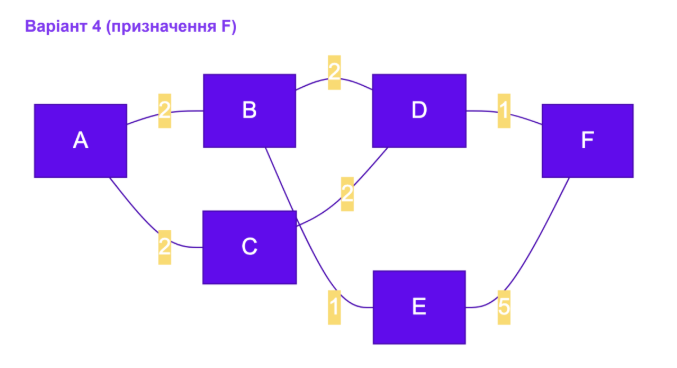

# Самостійна робота №12: Порівняння протоколів маршрутизації RIP, OSPF, BGP (Варіант №4)

## 1. Шлях за кількістю переходів (Hop Count, RIP)
У дистанційно-векторному підході (RIP) вага кожного ребра вважається рівною 1. 

Шляхи від `A` до `F`:
1. `A -> B -> D -> F` - **3 переходи** (ваги ігноруються)
2. `A -> C -> D -> F` - **3 переходи**
3. `A -> B -> E -> F` - **3 переходи**

* **Послідовність вузлів:** `A -> B -> D -> F` (або `A -> C -> D -> F`)
* **Кількість переходів:** **3**

---

## 2. Шлях за сумою ваг (Алгоритм Дейкстри, OSPF)
Алгоритм стану каналу (OSPF) враховує пропускну здатність каналів (ваги ребер).

### Таблиця ітерацій алгоритму Дейкстри:

| Крок | Оброблюваний вузол | Відстань до A | Відстань до B | Відстань до C | Відстань до D | Відстань до E | Відстань до F |
| :---: | :---: | :---: | :---: | :---: | :---: | :---: | :---: |
| **0** | `A` (початковий) | **0** | $\infty$ | $\infty$ | $\infty$ | $\infty$ | $\infty$ |
| **1** | `A` | 0 | **2** (через A) | **2** (через A) | $\infty$ | $\infty$ | $\infty$ |
| **2** | `B` | 0 | 2 | 2 | **4** (через B) | **3** (через B) | $\infty$ |
| **3** | `C` | 0 | 2 | 2 | 4 (через B/C) | 3 (через B) | $\infty$ |
| **4** | `E` | 0 | 2 | 2 | 4 | 3 | **8** (через E: 3+5) |
| **5** | `D` | 0 | 2 | 2 | 4 | 3 | **5** (через D: 4+1) |
| **6** | `F` | 0 | 2 | 2 | 4 | 3 | **5** |

* **Оптимальний шлях:** `A -> B -> D -> F`
* **Підсумкова вартість (сума ваг):** $2 + 2 + 1 = \mathbf{5}$

---

## 3. Порівняння шляхів
* **Результат:** Шлях за кількістю переходів (`A -> B -> D -> F`) та шлях за сумою ваг (`A -> B -> D -> F`) **збігаються**.
* **Пояснення:** У даній топології найкоротший за кількістю ребер маршрут одночасно виявився й найоптимальнішим за сумарною вагою (5 проти 8 через вузол E). Збіг виникає тоді, коли альтернативні довші шляхи містять канали з високою вартістю (наприклад, ребро `E-F` з вагою 5), що робить їх невигідними для OSPF, навіть якщо кількість переходів однакова.

---

## 4. Порівняльна таблиця RIP, OSPF, BGP та роль BGP

### Порівняльна таблиця протоколів

| Характеристика | RIP | OSPF | BGP |
| :--- | :--- | :--- | :--- |
| **Тип алгоритму** | Дистанційно-векторний (Distance-Vector) | Стану каналу (Link-State) | Вектор шляхів (Path-Vector) |
| **Метрика** | Кількість переходів (Hop Count, max 15) | Вартість каналу (Cost = 100 Mbps / Bandwidth) | Атрибути (AS-Path, Local Pref, MED тощо) |
| **Область застосування** | Малі локальні мережі (LAN) | Внутрішньоавтономні мережі (IGP, корпоративні LAN/WAN) | Міжавтономна маршрутизація (EGP, глобальний Інтернет) |
| **Швидкість збіжності** | Низька (до кількох хвилин) | Висока (секунди) | Повільна/поміркована (налаштована під стабільність) |
| **Масштабованість** | Дуже низька | Висока (в межах однієї AS) | Екстремально висока (весь Інтернет) |

### Чому міжавтономна маршрутизація потребує окремого протоколу BGP?
Маршрутизація між автономними системами (AS) глобального Інтернету не може базуватися лише на технічних метриках (найкоротшому шляху чи найвищій швидкості), оскільки ключову роль відіграють економічні та політичні договірні відносини між провайдерами (peering та transit). Крім того, глобальна таблиця маршрутів містить понад 900 000 префіксів, і протоколи типу OSPF просто не здатні обробити таку кількість даних через необхідність зберігати повну топологію мережі. BGP дозволяє гнучко керувати трафіком на основі політик бізнесу та ефективно масштабуватися без обміну повним станом усіх каналів світу.

---

##  Висновок
Під час виконання самостійної роботи було практично порівняно дистанційно-векторний підхід та підхід стану каналу на прикладі Варіанта №4. Було побудовано таблицю ітерацій алгоритму Дейкстри для знаходження найкоротшого шляху за вагами та з'ясовано причини необхідності використання спеціалізованого протоколу BGP для глобальної міжавтономної маршрутизації в Інтернеті.

---

##  Контрольні запитання

1. **Чому дистанційно-векторний протокол і протокол стану каналу можуть обрати різні маршрути для однієї пари вузлів?**  
   *Відповідь:* Тому що вони використовують різні метрики: дистанційно-векторні протоколи (наприклад, RIP) рахують виключно кількість проміжних маршрутизаторів (хопів), вважаючи всі канали однаковими, тоді як протоколи стану каналу (наприклад, OSPF) враховують реальну вартість та пропускну здатність ліній зв'язку.

2. **Опишіть один крок алгоритму Дейкстри своїми словами.**  
   *Відповідь:* На кожному кроці алгоритм обирає серед усіх ще не оброблених (не відвіданих) вузлів той, який має найменшу поточну розраховану відстань від джерела. Після цього він переглядає всіх його сусідів і, якщо шлях до сусіда через поточний вузол виявляється коротшим за раніше відомий, оновлює значення відстаней до цих сусідів.

3. **Чим відрізняється область застосування OSPF від BGP?**  
   *Відповідь:* OSPF є внутрішнім протоколом маршрутизації (IGP) і застосовується всередині однієї автономної системи (корпоративної мережі чи мережі одного провайдера) для швидкого пошуку найоптимальнішого шляху. BGP є зовнішнім протоколом (EGP) і слугує для обміну маршрутною інформацією між різними автономними системами глобального Інтернету.

4. **Чому вибір маршруту в BGP не зводиться лише до найкоротшої технічної відстані?**  
   *Відповідь:* У глобальному Інтернеті вибір маршруту визначається не швидкістю кабелю, а бізнес-правилами та політиками (policy-based routing). Провайдери спрямовують трафік через ті автономні системи, з якими у них укладено безкоштовні (peering) або вигідніші фінансові угоди (transit), навіть якщо цей шлях фізично є довшим.