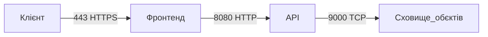

# Самостійна робота №15: Хмарні та контейнерні мережі, моніторинг

# Варіант №4

- **Застосунок:** файлове сховище (фронтенд, API, сховище об'єктів).
- **Вимога до ізоляції:** сховище доступне лише від API, без прямого доступу ззовні.

---

## 1. Мережева схема застосунку

Мережева схема розділена на два сегменти: публічний, доступний ззовні, та приватний, ізольований від зовнішньої мережі.

### Опис мережевих сегментів

**Публічний сегмент:**
- Фронтенд приймає зовнішні запити від клієнтів через порт `443` (HTTPS).

**Приватний сегмент:**
- API приймає внутрішні запити від фронтенду через порт `8080` (HTTP).
- Сховище об'єктів доступне виключно для API через порт `9000` (TCP).
- Прямий доступ до сховища з Інтернету заборонений.

---

## 2. Вибір режиму мережі контейнерів

Для розгортання файлового сховища обрано користувацьку мережу типу `bridge`.

Цей режим підходить для багатоконтейнерних застосунків, які працюють на одному хості. Він забезпечує мережеву ізоляцію контейнерів і дозволяє їм взаємодіяти між собою за допомогою вбудованого DNS-сервера Docker.

Режим `host` не обрано, оскільки він використовує мережевий простір хоста, зменшує ізоляцію та може спричинити конфлікти портів.

Режим `overlay` не потрібен для звичайного локального розгортання, оскільки переважно використовується для взаємодії контейнерів на різних вузлах, наприклад у Docker Swarm.

Завдяки вбудованому DNS Docker сервіси можуть звертатися один до одного за іменами в межах спільної мережі.

Для забезпечення безпеки порт сховища об'єктів не публікується на хості, а доступ до нього дозволяється лише з боку API.

---

## 3. Таблиця груп безпеки

| Сервіс | Дозволений вхідний порт | Дозволене джерело |
|---|---|---|
| **Фронтенд** | `443` (HTTPS) | Клієнт з Інтернету |
| **API** | `8080` (HTTP) | Фронтенд |
| **Сховище об'єктів** | `9000` (TCP) | API |

### Основні правила безпеки

- Відкривати назовні лише порт `443` для HTTPS.
- Не публікувати порт `8080` для прямого доступу з Інтернету.
- Не публікувати порт `9000` на хості.
- Дозволяти доступ до сховища об'єктів лише для API.
- Використовувати автентифікацію та обмеження доступу між сервісами.

---

## 4. Метрики та діагностика недоступності

### 4.1. Основні метрики

1. **Затримка відповіді (Latency / Response Time)** - час, необхідний сервісу для обробки запиту.
2. **Частка помилок (Error Rate)** - відсоток запитів, які завершилися помилками. Варто окремо відстежувати відповіді `4xx` і `5xx`.
3. **Healthcheck** - перевірка працездатності сервісів за спеціальними ендпоінтами, наприклад `/health`.
4. **Використання ресурсів (Resource Utilization)** - рівень використання процесора (CPU) та оперативної пам'яті (RAM) контейнерами.

### 4.2. Порядок діагностики недоступності

**Крок 1. Перевірка DNS і мережевих портів**

Перевірити, чи правильно визначається ім'я сервісу та чи доступний потрібний порт. Для цього можна використати `nslookup` або `nc`.

**Крок 2. Перевірка Healthcheck і помилок**

Перевірити стан контейнерів, ендпоінти `/health` та журнали помилок, щоб визначити, який саме сервіс не працює.

**Крок 3. Аналіз логів і ресурсів**

Переглянути журнали контейнерів за допомогою команди `docker logs`, а також перевірити використання CPU і RAM. Це допоможе виявити помилки конфігурації, програмного коду або нестачу ресурсів.

---

## Висновок

Під час виконання самостійної роботи було розроблено мережеву схему файлового сховища з урахуванням вимог безпеки. Обґрунтовано вибір мережі `bridge`, визначено правила доступу для фронтенду, API та сховища об'єктів. Також було обрано основні метрики моніторингу й описано послідовність діагностики недоступності сервісів.

У результаті роботи було закріплено знання про контейнерні мережі, ізоляцію сервісів, контроль доступу та моніторинг застосунків.

---

## Контрольні запитання

### 1. Чому базі даних чи черзі повідомлень зазвичай не варто відкривати порт назовні?

**Відповідь:** Відкриття портів баз даних і черг повідомлень в Інтернет збільшує ризик несанкціонованого доступу, атак на паролі та використання вразливостей. Такі сервіси краще розміщувати в приватній мережі й дозволяти підключення лише потрібним компонентам застосунку.

### 2. Який режим мережі контейнерів підходить для сервісу без потреби в максимальній ізоляції, і чому це рідко виправданий вибір?

**Відповідь:** Для такого сервісу можна використовувати режим `host`, у якому контейнер використовує мережевий простір хост-системи. Проте цей режим зменшує мережеву ізоляцію, може спричинити конфлікти портів і підвищує ризики безпеки. Тому його використовують лише за наявності конкретної потреби.

### 3. Яку перевірку варто виконати першою при повідомленні «сервіс недоступний»?

**Відповідь:** Спочатку потрібно перевірити стан сервісу, правильність DNS-імені та доступність потрібного мережевого порту. Це допоможе швидко визначити, чи пов'язана проблема з роботою сервісу, налаштуванням мережі або з'єднанням між контейнерами.
