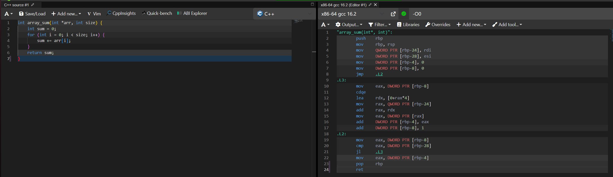
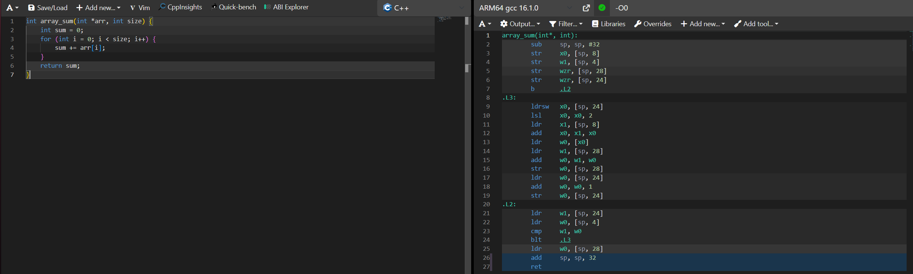
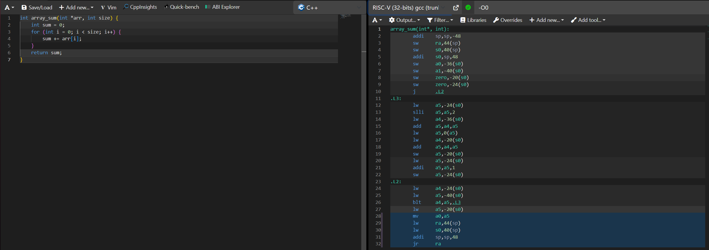

# Самостійна робота №7: Порівняння систем команд x86, ARM, RISC-V

##  Мета роботи

Навчитися читати асемблерний вивід компілятора для різних архітектур та порівнювати інженерні рішення CISC-архітектури (x86-64) і RISC-архітектур (ARM64, RISC-V).

---

##  Вихідний код функції (C)

Функція для обчислення суми елементів масиву array_sum:

```c
int array_sum(int *arr, int size) {
    int sum = 0;
    for (int i = 0; i < size; i++) {
        sum += arr[i];
    }
    return sum;
}
```

---

##  Асемблерний вивід для трьох архітектур 

### 1. Архітектура x86-64 (CISC)

*Місце для скриншота асемблерного коду x86-64.*

### 2. Архітектура ARM64 (RISC)

*Місце для скриншота асемблерного коду ARM64.*

### 3. Архітектура RISC-V (RISC)

*Місце для скриншота асемблерного коду RISC-V.*

---









##  Результати аналізу

### Таблиця 1. Порівняння кількості інструкцій

| Архітектура | Кількість інструкцій у тілі функції |
|---|---:|
| **x86-64** | ~17 |
| **ARM64** | ~20 |
| **RISC-V** | ~22 |

*Примітка: значення орієнтовні. Фактична кількість інструкцій залежить від компілятора, його версії та налаштувань.*

### Таблиця 2. Використання регістрів

| Архітектура | Регістри аргументів | Регістр результату |
|---|---|---|
| **x86-64** | rdi — адреса масиву, rsi — розмір | eax |
| **ARM64** | x0 — адреса масиву, w1 — розмір | w0 |
| **RISC-V** | a0 — адреса масиву, a1 — розмір | a0 |

---

##  Висновок

У цій роботі було розглянуто особливості архітектур x86-64, ARM64 та RISC-V. Було встановлено, що x86-64 належить до архітектур CISC, а ARM64 і RISC-V — до RISC.

Архітектури відрізняються набором команд, способом роботи з пам’яттю та використанням регістрів. У RISC-архітектурах арифметичні операції зазвичай виконуються над даними в регістрах, а для завантаження даних із пам’яті використовуються окремі команди, наприклад `lw` і `ldr`. В архітектурі x86-64 деякі арифметичні команди можуть безпосередньо працювати з операндами в пам’яті.

Отже, порівняння асемблерного коду допомагає зрозуміти, як одна й та сама програма реалізується на різних архітектурах процесорів.


